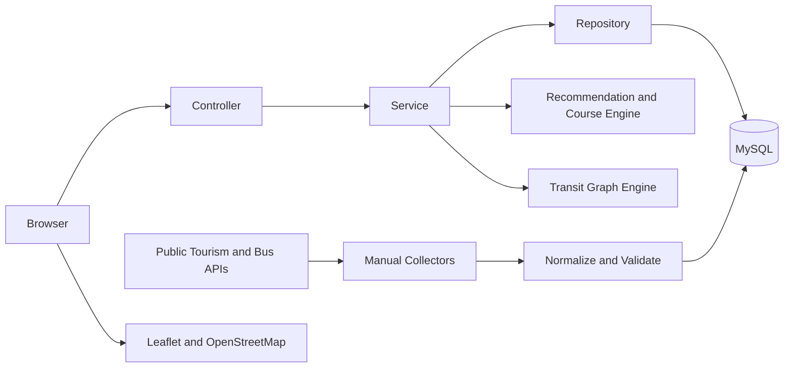
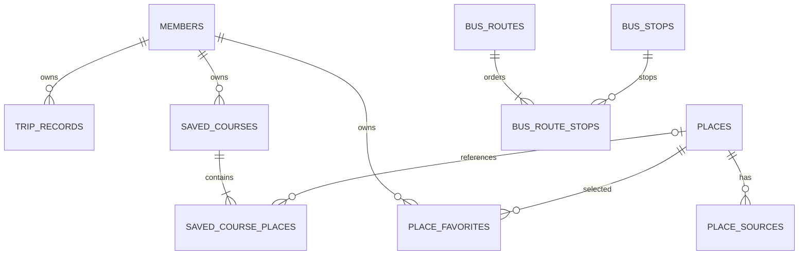

# City Roulette

부산 공공 관광데이터를 검색하고, 사용자 조건에 맞는 장소를 추천한 뒤 룰렛 방식으로
1~5개 장소의 즉흥 여행 코스를 만드는 Spring Boot 웹 서비스입니다.

공개 배포 URL은 없습니다. 검증된 로컬 시연 주소는 `http://127.0.0.1:18090/`입니다.

## 프로젝트 목적

여행자는 여러 사이트에서 장소, 지도, 대중교통 정보를 따로 찾아야 하고 목적지를
결정하는 데에도 많은 시간을 씁니다. City Roulette는 부산 관광 장소를 하나의 DB로
통합하고, 선호 카테고리와 출발지, 지역, 랜덤성을 이용해 후보를 좁힌 뒤 재미있는 코스로
제시합니다. 확인되지 않은 이동시간이나 비용은 임의로 만들지 않고 데이터 한계를 화면에
표시합니다.

## 핵심 기능

- 관광지·음식점·문화시설 검색, 카테고리·구군 필터, 서버 측 페이지네이션
- 장소 상세, 출처·이미지 이용 정보, Leaflet 지도, 주변 정류장 조회
- 카테고리·거리·다양성·데이터 품질·검증된 교통 연결성을 이용한 개인화 추천
- 추천 점수 기반 룰렛, 고정 seed 재현, 역할 그룹 다양성, 1~5개 장소 방문 순서 생성
- 회원가입·로그인과 CSRF 보호
- 회원별 코스 저장·수정·삭제, 즐겨찾기, 여행 기록 PNG 업로드·다운로드
- TourAPI와 부산 공공데이터 수집·정규화·멱등 저장 프로그램
- 버스 정류장·노선·정차 순서 저장, 직통 및 최대 1회 환승 후보 탐색
- `demo` 프로필과 Windows PowerShell 로컬 시연 스크립트

## 기술 스택

| 영역 | 기술 |
| --- | --- |
| Backend | Java 17, Spring Boot 3.5.16, Spring MVC, Spring Data JPA, Spring Security |
| Frontend | Thymeleaf, JavaScript, CSS, Leaflet, OpenStreetMap tiles |
| Database | MySQL 8.0.46, Flyway V1~V12 |
| Test | JUnit 5, Spring Boot Test, Spring Security Test, H2 Fixture |
| Build | Gradle Wrapper 8.14.3 |

## 시스템 아키텍처



일반 웹 요청은 Controller → Service → Repository 구조를 따릅니다. 외부 API 수집기는
웹 서버 시작과 분리된 수동 Runner이며, 기본 설정에서는 자동 실행되지 않습니다.

## 데이터베이스



`places`는 화면과 추천에 사용하는 대표 장소를 저장하고, `place_sources`는 공급자와
외부 ID, 출처, 라이선스를 보존합니다. `(provider, external_id)`는 유일합니다.
`import_runs`는 수집 통계를, `place_merge_candidates`는 자동 병합하지 않은 유사 후보를
기록합니다. 전체 스키마는 `src/main/resources/db/migration`의 V1~V12가 정의합니다.

| 검증 데이터 | 건수 |
| --- | ---: |
| Place / PlaceSource | 395 / 395 |
| BusStop / BusRoute / BusRouteStop | 30 / 1 / 20 |
| 관광 공급자 | 4개 |
| 동일 공급자·외부 ID 중복 | 0 |

## 추천 및 룰렛 알고리즘

추천 점수의 각 요소는 0~100으로 정규화합니다.

| 요소 | 기본 가중치 |
| --- | ---: |
| 선호 카테고리 | 30 |
| 출발지와의 Haversine 직선거리 | 30 |
| 후보 카테고리 다양성 | 15 |
| 주소·설명·이미지 등 데이터 품질 | 15 |
| 검증 가능한 정적 교통 연결성 | 10 |

교통 데이터를 평가할 수 없으면 교통 가중치를 제외하고 나머지 항목을 재정규화합니다.
랜덤성은 점수를 변조하지 않고 상위 후보 풀의 범위와 가중 추출 확률에 적용합니다.
동일한 데이터·요청·`randomSeed`는 같은 결과를 재현합니다.

코스는 비복원 추출로 중복 장소를 막고, 장소를 관광·음식·카페·문화·쇼핑·자연 등
역할 그룹으로 분류해 다양성을 보정합니다. 최대 5개 장소의 순열을 비교하여 음식점 및
동일 역할의 연속을 줄이고, 허용 거리 범위 안에서 Haversine 직선거리를 사용해 방문
순서를 정합니다. 실제 도로 경로나 이동시간 최적화로 해석하면 안 됩니다.

## 공공데이터 공급자

실제 통합 DB에는 다음 4개 공급자가 들어 있습니다.

- 한국관광공사 TourAPI `KorService2`
- 부산광역시 부산명소정보
- 부산광역시 부산맛집정보
- 부산광역시 갈맷길 관광정보

부산푸디투어 응답은 미식 테마 콘텐츠로 확인되어 개별 `Place` 저장에서 제외했습니다.
부산버스정보시스템은 관광 장소와 분리된 버스 정적 데이터에 사용했습니다.

## 로컬 실행

### 일반 개발 실행

필수 환경변수는 `DB_HOST`, `DB_PORT`, `DB_NAME`, `DB_USERNAME`, `DB_PASSWORD`입니다.
외부 API 기능을 사용할 때만 해당 키를 추가합니다. 키와 비밀번호를 소스나
`application*.properties`에 저장하지 마세요.

```powershell
$env:JAVA_HOME = 'C:\Program Files\Java\jdk-17'
.\gradlew.bat bootRun
```

### 검증된 발표용 demo 실행

`.runtime-demo`의 시연용 MySQL 복제본이 준비된 Windows PC에서 실행합니다.

```powershell
.\scripts\demo\run-demo.ps1 -Username <demo-db-user>
```

빈 비밀번호를 명시적으로 허용해야 하는 준비된 로컬 복제본에만
`-AllowEmptyPassword`를 추가합니다. 실행 후 `http://127.0.0.1:18090/`에 접속하고,
종료는 `Ctrl+C` 후 `Y`입니다. 자세한 절차는
[`docs/final-demo-guide.md`](docs/final-demo-guide.md)를 참고하세요.

## 테스트 결과

- Java 17 `gradlew --no-daemon clean build`: 성공
- JUnit/Spring 테스트: 324개, 실패 0, 오류 0, 건너뜀 0
- Chromium GUI QA: 검색, 상세, 지도, 추천, 룰렛, 로그인, 코스 저장, 즐겨찾기 확인
- 반응형: 1440×900, 1024×768, 768×1024, 390×844, 360×800 확인
- demo MySQL 및 Spring Boot 재시작 후 데이터 보존 확인
- PNG 업로드·다운로드, 회원 접근 제어, 재시작 후 SHA-256 일치 확인
- 비식별 데이터 덤프를 새 Flyway V12 DB에 복원해 395/395/30/1/20 확인

테스트 리포트는 빌드 후 `build/reports/tests/test/index.html`에서 확인할 수 있습니다.

## 주요 화면

| 화면 | 파일 |
| --- | --- |
| 관광지 목록 | `docs/qa/screenshots/02-places-desktop.png` |
| 장소 상세 지도 | `docs/qa/screenshots/03-place-detail-map-desktop.png` |
| 개인화 추천 | `docs/qa/screenshots/05-personalized-recommendation-desktop.png` |
| 룰렛 코스 | `docs/qa/screenshots/06-course-roulette-desktop.png` |
| 저장 코스 | `docs/qa/screenshots/08-saved-course-detail-desktop.png` |

## 제한사항

- 버스 데이터는 부산 100번 노선 1개 중 검증된 20개 정차 구간을 포함한 부분 데이터입니다.
- 시간표, 방문 소요시간, 입장료, 교통요금, 실제 도보·도로 거리를 계산하지 않습니다.
- 실시간 버스 도착정보와 부산 전체 노선망은 구현 범위가 아닙니다.
- Leaflet JavaScript와 OpenStreetMap 지도 타일은 인터넷 연결에 의존합니다.
- Kakao·ODsay 키가 없으면 해당 외부 기능은 안전한 오류 안내를 표시합니다.
- 공개 배포 없이 로컬 시연 환경만 검증했습니다.

## 문서

- [최종 프로젝트 보고서](docs/final-project-report.md)
- [발표 시연 가이드](docs/final-demo-guide.md)
- [최종 시연 검증](docs/phase5-d-final-demo-rehearsal.md)
- [관광데이터 확대 수집](docs/phase4-c3-tourism-data-scale-up.md)
- [버스 경로 탐색](docs/phase3-a2-transit-route-planner.md)
- [추천 엔진](docs/phase3-b-recommendation-engine.md)
- [룰렛 코스](docs/phase3-c-course-roulette.md)

## 라이선스와 출처

애플리케이션 소스의 라이선스는 저장소의 `LICENSE`를 따릅니다. 관광 데이터와 이미지는
각 `PlaceSource`에 저장된 공급자, 원본 URL, content/image license 및 attribution을
따릅니다. 이용 조건이 불명확한 이미지는 화면에서 표시하지 않습니다.
