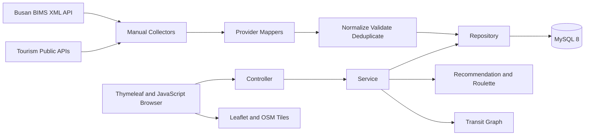
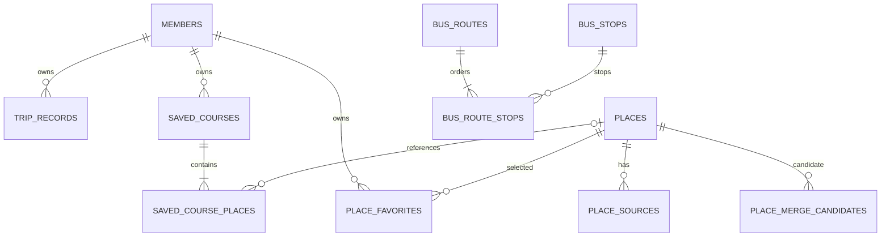

# City Roulette 최종 프로젝트 보고서

검증 기준일: 2026-11-07

## 1. 프로젝트 개요

### 1.1 프로젝트명

City Roulette: 부산 공공데이터 기반 즉흥 여행 추천 서비스

### 1.2 개발 동기

부산에서 짧은 여가 시간을 보내려는 사용자는 장소 검색, 지도 확인, 대중교통 탐색을
서로 다른 서비스에서 반복해야 한다. 목적지를 미리 정하지 못한 경우에는 후보를 비교하는
과정 자체가 부담이 된다. City Roulette는 공공 관광데이터를 하나의 장소 DB로 정리하고,
사용자가 입력한 출발지와 선호 조건을 기준으로 후보를 추천한 뒤 룰렛으로 여러 장소를
선택해 즉흥 여행 코스로 제시한다.

### 1.3 해결하려는 문제

- 여러 공공 API의 다른 필드와 카테고리를 한 화면에서 검색하기 어렵다.
- 동일 장소가 다른 공급자에 중복될 수 있고 출처·라이선스가 다르다.
- 추천 서비스가 근거 없는 이동시간이나 비용을 정확한 값처럼 보여줄 수 있다.
- 랜덤 추천은 재미가 있지만 품질과 재현성이 부족할 수 있다.
- 생성한 결과를 회원이 다시 확인할 개인 기능이 필요하다.

### 1.4 주요 사용자

- 부산에서 즉흥적으로 갈 곳을 찾는 시민과 관광객
- 카테고리와 지역으로 부산 장소를 탐색하려는 비회원
- 추천 코스와 즐겨찾기, 여행 기록을 저장하려는 회원
- 공공데이터 수집·정제 과정을 확인하려는 프로젝트 평가자

## 2. 요구사항 분석

### 2.1 사용자 기능

| 구분 | 기능 |
| --- | --- |
| 공개 | 메인, 관광지 목록·검색·필터, 상세, 지도, 주변 정류장 |
| 공개 | 개인화 추천, 룰렛 코스 생성, 정적 버스 경로 후보 조회 |
| 회원 | 코스 저장·목록·상세·제목 수정·삭제 |
| 회원 | 장소 즐겨찾기 등록·해제·목록 |
| 회원 | 여행 기록 작성, PNG 첨부, 다운로드 |
| 개발/수동 | 관광·버스 API 수집, 품질 분석, 실행 이력 검증 |

### 2.2 접근 제어

Spring Security form login과 BCrypt를 사용한다. 목록·검색·추천·코스 생성은 비회원에게
공개한다. `/my/**`, 코스 저장 API, 즐겨찾기 API는 인증을 요구한다. 회원 ID를 요청에서
신뢰하지 않고 서버 인증정보에서 조회한다. POST·PATCH·DELETE 요청은 CSRF 보호를
유지한다. 관광 데이터 동기화와 개발 진단은 관리자 권한 또는 로컬 수동 Runner로
제한하며 관리자 권한을 우회하지 않는다.

### 2.3 기능 요구사항

- 키워드, 카테고리, 구군 조건을 동시에 적용하고 URL에 검색 상태를 유지한다.
- 전체 데이터를 브라우저로 전송하지 않고 DB 페이징을 사용한다.
- 좌표·이미지·주소가 없어도 상세와 빈 상태가 깨지지 않아야 한다.
- 추천 점수와 이유, 직선거리, 교통 검증 상태, 데이터 한계를 반환한다.
- 동일 seed와 동일 후보 입력은 같은 추천·코스 결과를 반환해야 한다.
- 코스에는 같은 장소가 중복되면 안 되며 1~5곳을 지원한다.
- 회원 데이터는 소유자만 조회·변경할 수 있다.
- 수집기는 dry-run, 건수 제한, 멱등 저장, 오류 집계를 지원해야 한다.

### 2.4 비기능 요구사항

- Java 17과 MySQL 8에서 실행한다.
- Controller → Service → Repository 계층을 유지한다.
- 외부 API 키와 DB 비밀번호를 소스·응답·로그에 노출하지 않는다.
- 데이터 수집을 서버 시작 시 자동 실행하지 않는다.
- 데스크톱, 태블릿, 360~390px 모바일에서 가로 오버플로가 없어야 한다.
- 키보드 포커스, label, alt, reduced motion을 고려한다.
- 원본 DB와 사용자 데이터를 삭제하거나 초기화하지 않는다.

## 3. 시스템 설계

### 3.1 전체 아키텍처



웹 기능과 수집 프로그램을 분리했다. 웹 요청은 3계층을 거치며 JPA Entity를 REST 응답에
직접 노출하지 않는다. 수집기는 명시적 실행 옵션이 있어야 동작하고 dry-run에서는 DB를
변경하지 않는다.

### 3.2 핵심 모듈

| 모듈 | 책임 |
| --- | --- |
| Place Explorer | 검색 조건 조합, 페이징, 상세·출처·주변 정류장 조합 |
| Collection | 공급자 API 호출, DTO 파싱, 페이지네이션, 재시도·오류 분류 |
| Normalization | 장소명·주소·구군·카테고리·좌표 정규화 |
| Import | Place·PlaceSource upsert, 중복 원천 차단, 실행 통계 |
| Recommendation | 후보 제한, 점수 계산, 교통 점수 재정규화, seed 추출 |
| Course | 비복원 선택, 역할 다양성, 방문 순서, 생성 토큰 |
| Transit | 방향성 있는 정차 그래프, 직통·최대 1회 환승 후보 |
| Member Data | 코스·즐겨찾기·여행 기록 소유권과 CSRF |
| Demo | 격리 MySQL 시작·검증·종료, demo 프로필 안전 설정 |

### 3.3 외부 API 구조

| 공급자 | 실제 DB 반영 | 용도 |
| --- | ---: | --- |
| 한국관광공사 TourAPI | 110 Source | 관광지·음식점·문화·행사 등 |
| 부산명소정보 | 100 Source | 부산 명소 |
| 부산맛집정보 | 100 Source | 부산 음식점 |
| 부산 갈맷길 관광정보 | 85 Source | 갈맷길의 확인된 장소성 콘텐츠 |
| 부산푸디투어 | Place 저장 제외 | 테마 콘텐츠로 분류 |
| 부산버스정보시스템 | 별도 버스 테이블 | 정류장·노선·정차 순서 |
| Kakao Local | demo에서 미사용 | 선택적 출발지 검색 |
| ODsay | 보조 기능 | 키가 있을 때 기존 대중교통 검색 |

## 4. DB 설계

### 4.1 ERD



### 4.2 주요 테이블

| 테이블 | 핵심 데이터와 제약 |
| --- | --- |
| `members` | username·email UNIQUE, BCrypt password, role |
| `places` | 대표 이름·카테고리·주소·구군·좌표·설명·이미지·정규화 필드 |
| `place_sources` | provider·external_id UNIQUE, 출처 URL·라이선스·동기화 시각 |
| `import_runs` | provider, dry-run, 페이지·수신·신규·갱신·중복·실패 통계 |
| `bus_stops` | 공식 정류장 ID UNIQUE, ARS, 좌표 |
| `bus_routes` | 외부 노선 ID UNIQUE, 노선 번호·유형·기종점 |
| `bus_route_stops` | 노선 FK, 정류장 FK, 정차 순서 UNIQUE |
| `saved_courses` | 회원 FK, 출발지, 요청 조건, version 낙관적 잠금 |
| `saved_course_places` | 방문 순서·장소 스냅샷·점수·거리·교통 상태 |
| `place_favorites` | 회원·장소 UNIQUE, 두 FK |
| `trip_records` | 회원 FK, 방문 정보, 업로드 메타데이터 |

Flyway V1~V12가 테이블과 인덱스를 순서대로 관리한다. V12는 공급자와 무관하게 적용되던
legacy `external_id` 유일 인덱스를 제거하고 공급자 범위의 식별 체계를 유지한다.

## 5. 핵심 알고리즘

### 5.1 수집·정규화·중복 제거

```text
Provider API
  -> Raw DTO parsing
  -> Required field and record type validation
  -> Name, address, district, category normalization
  -> WGS84 coordinate validation
  -> (provider, external_id) lookup
  -> Insert or update Place and PlaceSource
  -> Similar place candidate recording
  -> ImportRun statistics
```

동일 공급자와 외부 ID는 동일 원천으로 판단해 연결된 Place를 갱신한다. 다른 공급자의
장소는 이름·주소·좌표가 비슷해도 자동 병합하지 않고 검토 후보로 남긴다. 공급자별
페이지 크기를 고정해 마지막 페이지의 오프셋 중복을 방지했다. 100건 단계 재수집 후
Place와 PlaceSource 건수가 395/395로 유지되어 신규 중복이 0임을 확인했다.

### 5.2 개인화 추천 점수

모든 구성 점수는 0~100이며 기본 가중치는 다음과 같다.

```text
Score = Category 30% + Distance 30% + Diversity 15%
      + Data Quality 15% + Verified Transit 10%
```

- 거리 점수는 최대 50km 범위의 Haversine 직선거리다.
- 교통을 평가할 수 없는 경우 0점으로 벌점을 주지 않고 해당 가중치를 제외해 재정규화한다.
- 후보는 DB에서 먼저 카테고리·구군으로 거르고 최대 200건만 읽는다.
- 상위 후보 중 최대 10건만 정적 교통 엔진으로 평가한다.
- 시간·가격 데이터가 없으면 필터 근거로 사용하지 않고 제한사항을 반환한다.

### 5.3 랜덤 seed와 역할 다양성

`randomness=0`은 점수순 결정론적 선택이다. 랜덤성이 증가하면 상위 후보 풀을 넓히고
`score + 1` 기반 가중 비복원 추출을 수행한다. 같은 seed와 같은 후보 입력은 같은 결과를
반환한다. 장소를 관광·음식·카페·문화·쇼핑·자연 등의 역할로 매핑하고 새 역할에 novelty
bonus 12점을 부여한다.

### 5.4 방문 순서

최대 5곳이므로 가능한 순열 최대 120개를 비교한다. 음식점 연속 횟수, 동일 역할 연속
횟수, 총 직선거리, Place ID 순으로 안정적으로 정렬한다. 기존 nearest-neighbor의 거리
상한을 넘지 않는 순열만 허용한다. 결과는 실제 도로 최적 경로나 이동시간을 뜻하지 않는다.

### 5.5 버스 직통·환승 탐색

노선 ID, 정류장 ID, 방향, 정차 순서를 보존한 방향성 그래프를 사용한다. 직통은 같은
노선에서 승차 순서가 하차 순서보다 앞이고 중간 정차 순번이 1씩 연속될 때만 VERIFIED로
반환한다. 환승은 동일 공식 정류장 ID에서만 최대 1회 허용하며 두 구간 모두 방향과 연속
순서를 검증한다. 이름만 같거나 좌표만 가까운 정류장을 자동 환승점으로 사용하지 않는다.

## 6. 구현 결과

### 6.1 관광지 탐색과 지도

395개 장소를 서버 측 페이징으로 조회한다. 키워드·카테고리·구군을 동시에 적용하고,
상세 페이지에서 대표 이미지, 주소, 설명, 출처, 동기화 시각, Leaflet 지도와 주변 정류장을
표시한다. 데이터가 없으면 기본 이미지와 빈 상태 안내를 사용한다.

### 6.2 추천과 룰렛

추천 API는 점수 구성, 이유, 직선거리, 교통 검증 상태와 데이터 한계를 반환한다. 룰렛은
서버가 선택한 장소를 브라우저 애니메이션과 동일하게 표시하고 중복 요청을 막는다.
`prefers-reduced-motion`에서는 애니메이션을 줄인다.

### 6.3 회원 기능

회원은 생성된 코스를 1회용 저장 토큰으로 저장하고 자신의 코스만 조회·수정·삭제한다.
version 충돌은 HTTP 409로 처리한다. 즐겨찾기는 `(member_id, place_id)` UNIQUE로 동시
중복을 막는다. 여행 기록은 PNG 메타데이터를 DB에 저장하고 실제 파일은 프로필별 저장
디렉터리에 보존하며 소유자만 다운로드할 수 있다.

### 6.4 반응형 UI

공통 header·footer·button·card·form·empty/loading/error 상태를 정리했다. 실제 장소
이미지와 라이선스 정책을 유지하고 긴 장소명, 지도, 체크박스, 룰렛이 모바일에서 가로로
넘치지 않도록 수정했다.

## 7. 테스트

### 7.1 자동화 테스트

- Java 17 `gradlew --no-daemon clean build` 성공
- 테스트 324개, 실패 0, 오류 0, 건너뜀 0
- 인증·CSRF·소유권·409 충돌·파일 접근 제어
- 공급자 파싱·정규화·좌표·멱등성
- 추천 점수·seed·후보 제한·부분 교통 데이터
- 룰렛 중복 방지·다양성·순서·거리
- 버스 XML 보안·정차 순서·직통·환승 Fixture

### 7.2 MySQL 검증

- MySQL 8.0.46, Flyway V12
- Place/PlaceSource 395/395, 공급자 원천 중복 0, FK 고아 0
- BusStop/BusRoute/BusRouteStop 30/1/20
- 재수집 후 건수 증가 0
- 제출용 비식별 덤프를 새 DB에 복원하고 동일 건수 확인
- 복원 DB의 회원·코스·즐겨찾기·여행기록 0

### 7.3 GUI와 반응형

Chromium에서 42개 브라우저·보안·데이터 항목을 최종 통과했다. 1440×900, 1024×768,
768×1024, 390×844, 360×800에서 목록, 상세, 추천, 룰렛, 저장 코스, 즐겨찾기를 확인했다.
Phase 5-D 리허설에서 검색부터 코스 저장까지 약 3분 33초가 걸렸고 설명을 포함한 발표
시간은 5~7분으로 구성했다.

### 7.4 시연 환경

PowerShell 원클릭 스크립트로 demo MySQL 시작, 백업 해시와 기준 데이터 검증, Spring Boot
시작, 종료 시 MySQL 정리를 확인했다. DB·서버 포트 충돌, MySQL 미실행, 잘못된 로그인,
API 키 누락을 확인했다. PNG 업로드·다운로드와 재시작 후 SHA-256 일치도 검증했다.

## 8. 결과 및 한계

### 8.1 결과

- 네 관광 공급자의 Place/PlaceSource 395/395 통합
- 공급자별 Source: TourAPI 110, 부산명소 100, 부산맛집 100, 갈맷길 85
- 동일 `(provider, external_id)` 중복 0, FK 고아 0
- 검색·추천·룰렛·코스 저장·즐겨찾기·파일 기능 통합
- 테스트 324개 통과
- 실제 Chromium과 로컬 demo 프로필 검증

### 8.2 한계

- 버스는 100번 노선 130개 정차 중 저장된 상위 20개 구간만 검증했다.
- 부산 전체 버스망, 실시간 도착정보, 다중 환승 최적화는 지원하지 않는다.
- 실제 방문시간, 운영시간, 가격, 교통요금 데이터가 없어 시간·예산 충족을 확정하지 않는다.
- Haversine 거리는 실제 도보·도로·버스 이동거리가 아니다.
- 완전 오프라인에서는 Leaflet/OSM 외부 자산과 지도 타일이 표시되지 않을 수 있다.
- Kakao와 ODsay 실제 호출은 유효한 키가 있는 환경에서만 가능하다.
- 공개 배포 없이 Windows 로컬 시연만 검증했다.

## 9. 결론

City Roulette는 공공데이터 조사에서 시작해 실제 API 수집, 정규화, 출처·라이선스 보존,
검색 UI, 개인화 추천, 재현 가능한 룰렛, 회원별 저장 기능과 로컬 시연 환경까지 완성했다.
특히 확인되지 않은 이동시간과 비용을 생성하지 않고 부분 버스 데이터를 명확히 표시해
데이터 범위와 결과 표현을 일치시켰다.

향후에는 전체 정적 버스망과 운영시간·가격 데이터를 확보하고, 검증된 도보 네트워크와
실시간 정보에 짧은 TTL 캐시를 적용할 수 있다. 그 전까지 현재 결과는 부산 관광 장소를
탐색하고 즉흥 코스를 만드는 교육용 로컬 서비스로 활용할 수 있다.
