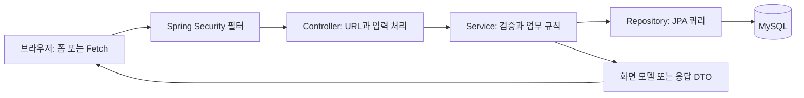
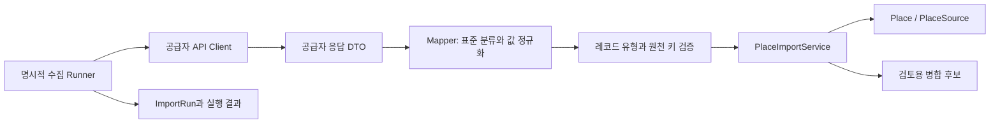
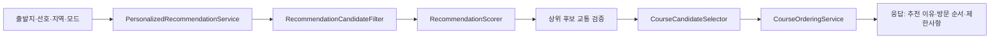

# 데이터 흐름

## 웹 요청과 회원 기능

공개 탐색은 로그인 없이 가능하다. 가입 입력은 회원 서비스가 검증하고 BCrypt 해시를 저장한다. 로그인 요청의 입력 비밀번호는 Spring Security가 저장된 해시와 비교한다. 회원 전용 코스, 즐겨찾기, 기록 및 다운로드에서는 인증된 사용자와 리소스의 소유권을 확인한다. 상태를 바꾸는 요청에는 CSRF 검증도 적용된다.

## 관광 데이터 수집

페이지별 응답은 공급자 오류와 레코드 상태를 확인해 분류한다. 이름과 주소의 표준형, 좌표 유효성, 카테고리, 출처와 이용 조건을 정리한다. 같은 공급자의 동일한 원천 ID는 기존 출처의 연결을 이용한다. 유사한 타 공급자 장소는 병합 후보로 기록한다. Dry-run은 결과를 집계하며 장소 데이터에 쓰지 않는다.

## 추천과 교통

버스 수집기는 XML을 파싱해 정류장·노선·정차 순서를 저장한다. 경로 검색은 주변 정류장을 찾은 뒤 DB에 존재하는 정차 관계의 방향과 연속성을 검사한다. ODsay 호출은 별도 기능이며 맞춤 코스에 필수로 쓰이지 않는다.
