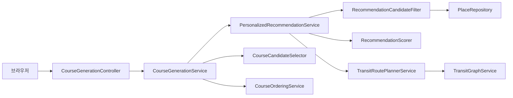

# 코드 단순화 결과

## 현재 실제 추천 실행 흐름

현재 맞춤 추천과 즉흥 룰렛은 위 경로를 사용한다. 별도로 기존 `/recommend` 화면과
`GET /api/recommendations/random`은 `RecommendationService`를 사용하며, ODsay 조회가
실패하면 장소 거리 기반 결과로 안전하게 대체한다.

## 제거한 중복

- `RecommendationController`와 `RecommendationPageController`에 각각 있던 위도, 경도,
  사용 가능 시간, 체류 시간, 후보 수 범위 검증을 `RecommendationInputValidator`로 통합했다.
- REST 최대 후보 수(5)와 화면 노출 최대 후보 수(3)는 같은 설정 안에서 이름을 분리했다.
- `CourseGenerationService`에 섞여 있던 후보 선택과 방문 순서 결정을 각각
  `CourseCandidateSelector`, `CourseOrderingService`로 분리했다.
- 추천 가중치 클래스에서 후보 수·거리·교통 조회 설정을 제거해 점수 가중치만 남겼다.

## 설정으로 이동한 값

| 설정 | 기존 위치 | 기본값 | 이유 |
|---|---|---:|---|
| 입력 시간 범위 | 추천 Controller | 60~720분 | REST와 화면 검증 통일 |
| 체류 시간 범위 | 추천 Controller | 30~240분 | REST와 화면 검증 통일 |
| 후보 수 상한 | 추천 Controller | REST 5, UI 3 | 공개 API와 화면 정책 구분 |
| 후보 풀 | 추천 Service | 200 | 데이터 증가 시 조정 가능 |
| 교통 반경/평가 수 | 추천 Service | 1,000m/10 | 부분 버스 데이터 정책 |
| 즉흥 후보 기준 좌표 | 코스 Service | 부산 중심 좌표 | 실제 출발지로 노출하지 않는 내부 계산값 |
| 코스 랜덤성/기본 개수 | 코스 Service | 100·40/3곳 | 서비스 정책값 |
| 다양성 보너스/거리 허용 | 코스 Service | 12/1.35배+1km | 코스 튜닝값 |

지구 반지름과 점수 정규화의 0~100 범위처럼 알고리즘 의미가 고정된 값은 코드에 유지했다.
카테고리 역할 문자열도 외부 설정이 아니라 도메인 분류 규칙이므로 코드에 유지했다.

## 설정 구조

- `RecommendationWeights`: 카테고리·거리·다양성·데이터 품질·교통 점수 비율만 담당한다.
- `RecommendationSettings`: defaults, limits, transit, origin, course 설정을 불변 record로 제공한다.
- 실제 값은 `application.properties`의 `recommendation.*` 그룹에서 한눈에 확인할 수 있다.

`external.api.tour.key`와 `tour.api.service-key`는 같은 환경변수를 가리키지만,
`TourismApiConfig`가 신규 설정과 기존 설정의 호환 처리를 실제로 수행하므로 삭제하지 않았다.

## 분리한 추천 로직

- `CourseGenerationService`: 요청 해석, 추천 호출, 응답과 저장 토큰 조립
- `CourseCandidateSelector`: 좌표 검증, 중복 제거, seed 기반 선택, 카테고리 다양성
- `CourseOrderingService`: nearest-neighbor 기준 순서와 역할 다양성 비교
- `RecommendationCandidateFilter`: DB 후보 조회와 외부 카테고리 별칭 정규화
- `RecommendationScorer`: 검증 가능한 항목의 0~100점 계산

분리 전 `CourseGenerationService`는 538줄에서 후보 선택과 순서 결정을 함께 처리했다.
분리 후 오케스트레이터는 325줄이며 선택기 154줄, 순서 서비스 124줄로 역할이 드러난다.

## 제거한 legacy 코드

실제 삭제한 legacy Service, Controller, DTO는 없다. 호출 관계를 확인한 결과 아래 경로가 모두
UI, REST API 또는 테스트에서 사용 중이므로 삭제 조건을 충족하지 않았다.

## 유지한 legacy/experimental 코드

- `RecommendationService`: 기존 `/recommend`와 랜덤 추천 API에서 사용한다. ODsay 연동 시연과
  장소 전용 fallback이 있어 현재 기능이다.
- `PersonalizedRecommendationService`: 현재 맞춤 추천과 코스 생성의 점수 기반 후보를 만든다.
- `TransitService`: ODsay 외부 API를 호출한다.
- `TransitRoutePlannerService`: 자체 MySQL 버스 정적 데이터로 직통·1회 환승 후보를 계산한다.
- `TransitGraphService`: 노선-정류장-정차 순서 그래프를 구성한다.
- KorService2와 ODsay DTO: 외부 JSON/XML 계약을 Entity와 분리하므로 유지한다.
- `CourseEstimateStatus.UNKNOWN`: 저장 코스/API 계약의 의미를 보존하므로 유지한다.

## Controller와 DTO 판단

추천 Controller는 URL이 겹치지만 역할이 다르다. `RecommendationPageController`는 Thymeleaf,
`RecommendationController`는 기존 GET 랜덤 API, `PersonalizedRecommendationController`는
현재 POST 맞춤 추천 API를 담당한다. API 계약을 바꾸지 않기 위해 합치지 않았다.
외부 API DTO 계층과 내부 응답 DTO도 서로 다른 계약을 표현하므로 통합하지 않았다.

## JavaScript 점검

`course-roulette.js`는 `friendlyLimitation()`에서 기술 용어를 한 번에 사용자 문구로 변환하고
있었다. 다른 화면의 `미분류`, `주소 없음`은 각 카드의 독립적인 빈 값 표시이므로 공통 모듈을
새로 만드는 편이 더 복잡하다고 판단해 유지했다.

## 리팩터링 전후 구조

| 항목 | 전 | 후 |
|---|---:|---:|
| production Java 파일 | 255 | 259 |
| production Java 줄 수 | 약 10,215 | 10,298 |
| CourseGenerationService | 538 | 325 |
| RecommendationPageController | 195 | 186 |
| RecommendationService | 142 | 142 |
| TransitRoutePlannerService | 139 | 139 |

전체 Java 줄 수는 설정 record, 공통 Validator와 두 책임 클래스가 추가되어 83줄 증가했다.
단순히 줄 수를 줄이려고 서로 다른 책임을 다시 합치지 않았으며, 가장 복잡했던 오케스트레이터는
213줄 감소했다. 기존 tracked 파일 기준 변경은 240줄 순감소이고, 새 책임 클래스가 이를 대체한다.

## 검증 결과

- `gradlew test`: 334개 통과
- 외부 API 실제 호출 및 실제 MySQL 쓰기: 이번 리팩터링 범위에서 수행하지 않음
- DB Entity/Flyway/API URL/응답 형식/Security 설정: 변경 없음
- Git commit/push: 수행하지 않음

## 남은 기술 부채

- 기존 ODsay 랜덤 추천과 현재 맞춤 추천은 모두 사용 중이지만 사용자 흐름이 완전히 통합되면
  기존 GET API를 별도 deprecation 절차로 정리할 수 있다.
- import/diagnostics 설정은 dev 전용이 많지만, STS 수동 검증 절차와 연결되어 있어 이번에는
  profile 이동을 하지 않았다.
- `CourseGenerationService`의 보조 카테고리 확보와 응답 조립은 향후 독립 변경 요구가 생길 때만
  추가 분리를 검토한다.
