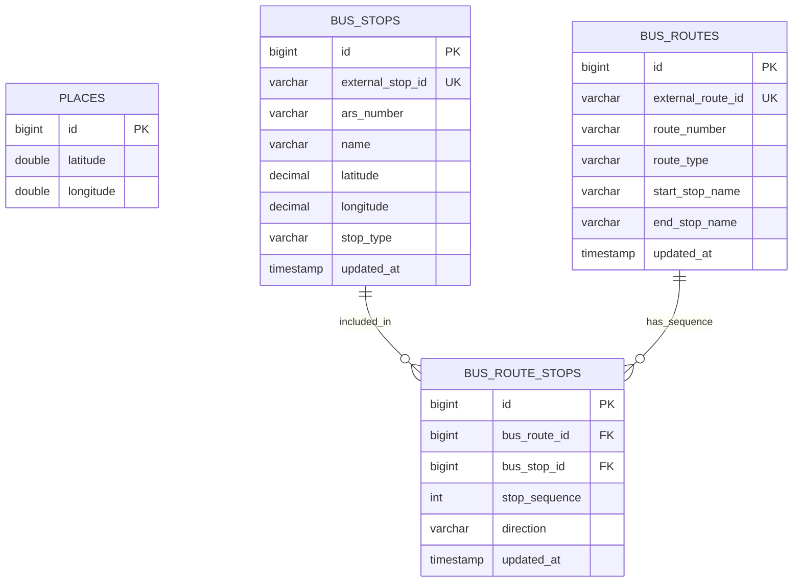

# Phase 2 B 2 부산 버스 교통 DB 및 수집 프로그램

작성일: 2026-10-28

## 구현 범위

부산버스정보시스템의 정류소, 노선, 노선별 정차 순서를 별도 교통 DB로 수집하고 기존 `places`의 좌표와
Haversine 직선거리로 연결한다. 수집기는 웹 Controller와 분리된 `ApplicationRunner`이며 기본적으로 비활성화되고
Dry-run으로 실행된다. 실시간 도착정보는 저장하지 않는다.

## 공식 API와 실제 응답 검증

공식 자료는 [부산광역시 부산버스정보시스템](https://www.data.go.kr/data/15092750/openapi.do)과 첨부된
`OpenAPI활용가이드_부산버스정보시스템_v2.0`을 기준으로 했다. 2026-10-28에 STS의
`BUSAN_BUS_API_KEY`를 값 노출 없이 사용해 다음을 표본 호출했다.

| 기능 | 엔드포인트 | 요청 조건 | 실제 결과 |
| --- | --- | --- | --- |
| 정류소 | `/busStopList` | `pageNo`, `numOfRows`, 선택 `bstopnm`, `arsno` | 코드 `00`, 전체 8,800건 |
| 노선 | `/busInfo` | 선택 `lineid`, `lineno` | `lineno=100` 검색에서 9건 |
| 노선 정류소 | `/busInfoByRouteId` | `lineid` | 노선 `5200100000`에서 130건 |
| 정류소 도착 | `/stopArrByBstopid` | `bstopid` | 설계만 반영, 저장하지 않음 |
| 노선 정류소 도착 | `/busStopArrByBstopidLineid` | `bstopid`, `lineid` | 설계만 반영, 저장하지 않음 |
| ARS 도착 | `/bitArrByArsno` | `arsno` | 설계만 반영, 저장하지 않음 |

정류소 응답 필드는 `bstopid`, `arsno`, `bstopnm`, `gpsx`, `gpsy`, `stoptype`다. 노선은 `lineid`,
`buslinenum`, `bustype`, `startpoint`, `endpoint`를 사용한다. 노선 정류소는 실제 응답의 `nodeid`,
`bstopidx`, `bstopnm`, `arsno`를 사용한다. 가이드에 선택 필드로 표시된 `direction`, `lat`, `lin`은
표본 정류소 항목에 없었으므로 필수로 가정하지 않는다.

## DB 구조



- `bus_stops.external_stop_id`와 `bus_routes.external_route_id`는 각각 UNIQUE다.
- ARS 번호와 내부 정류소 ID를 별도 필드로 보존한다.
- 노선 번호는 검색용이며 유일키가 아니다.
- `(bus_route_id, stop_sequence)`를 UNIQUE로 둔다. 같은 정류소 재방문은 서로 다른 순번으로 저장할 수 있다.
- 노선 정류소가 먼저 수집되면 `nodeid`와 이름으로 좌표 없는 정류소를 만들고, 이후 `busStopList` 수집이 좌표와
  ARS 번호를 갱신한다.
- 기존 Place, 회원, 파일, 여행 기록 테이블은 변경하지 않는다.

## XML 보안과 오류 처리

DOM 파서는 DOCTYPE 선언, 외부 일반 엔티티, 외부 파라미터 엔티티, 외부 DTD와 스키마 접근,
XInclude, 엔티티 확장을 모두 비활성화한다. `resultCode=00` 또는 `0000`만 성공으로 처리한다.
HTTP 429, 5xx와 전송 오류만 최대 3회 시도하고 인증 오류는 반복하지 않는다. API 키와 전체 요청 URL은
로그에 기록하지 않는다.

## 수집기 실행

필수 환경변수는 `BUSAN_BUS_API_KEY`다. 먼저 H2 또는 명확히 확인된 개발 DB에서 Dry-run한다.

정류소 10건:

```powershell
.\gradlew.bat bootRun --args="--spring.main.web-application-type=none --bus.import.enabled=true --bus.import.mode=STOPS --bus.import.dry-run=true --bus.import.page-size=10 --bus.import.limit=10"
```

100번 검색 결과 중 노선 1건과 정차 순서 20건:

```powershell
.\gradlew.bat bootRun --args="--spring.main.web-application-type=none --bus.import.enabled=true --bus.import.mode=ROUTES --bus.import.dry-run=true --bus.import.route-numbers=100 --bus.import.route-limit=1 --bus.import.route-stop-limit=20"
```

`mode`는 `STOPS`, `ROUTES`, `ALL`이다. 실제 저장은 개발 DB임을 확인한 뒤 `dry-run=false`로 변경한다.
Dry-run은 `bus_*`와 `import_runs`를 포함해 DB를 변경하지 않는다. 실제 저장 실행의 성공·실패 통계는
`import_runs`에 `BUSAN_BUS_STOP` 또는 `BUSAN_BUS_ROUTE` provider로 남는다.

`busStopList`는 페이지와 전체 건수를 제공하여 전체 순회가 가능하지만 8,800건 전체 수집은 이번 작업에서 하지
않았다. `busInfo`는 공식 명세상 노선 ID/번호 검색 API이며 전체 노선 페이지네이션이 없다. 따라서 현재 수집기는
검증된 노선 번호 목록을 `route-numbers`로 명시하도록 강제한다. 전체 노선 초기 적재에는 부산시가 제공하는 별도
정적 기준 데이터의 사용 가능 여부를 추가 확인해야 한다.

## 표본 Dry-run 결과

H2 테스트 DB에서 실제 API 응답을 사용했다. 예상 INSERT는 빈 DB 기준이며 실제 저장 건수는 0이다.

| Provider | Fetched | 예상 Inserted | Updated | Skipped | Failed | Route stops |
| --- | ---: | ---: | ---: | ---: | ---: | ---: |
| BUSAN_BUS_STOP | 10 | 10 | 0 | 0 | 0 | 0 |
| BUSAN_BUS_ROUTE | 1 | 1 | 0 | 0 | 0 | 20 |

통합 테스트에서는 같은 정류소와 노선을 두 번 저장해도 정류소 1건, 노선 1건, 서로 다른 순번의 연결 2건만
유지됨을 확인했다.

## REST API

```text
GET /api/bus/stops?name=부산시청&page=0&size=20
GET /api/bus/stops/{id}
GET /api/bus/routes?number=100&page=0&size=20
GET /api/bus/routes/{id}
GET /api/bus/routes/{id}/stops
GET /api/places/{placeId}/nearby-bus-stops?radius=500
```

검색 반경은 50~3,000m로 제한한다. 응답의 `distanceType`은
`HAVERSINE_STRAIGHT_LINE_NOT_WALKING_DISTANCE`이며 거리순으로 정렬한다. 장소가 없으면 404, 장소에 좌표가
없으면 422를 반환한다. Haversine 결과는 직선거리이며 실제 도보 거리나 접근 가능한 보행 경로가 아니다.

## 실시간 도착정보 계획

가이드는 데이터 갱신 주기를 실시간 1분으로 설명하고 개발계정 트래픽은 일 10,000건이다. 도착정보는 영구
저장하지 않고 사용자 요청 시 `bstopid` 또는 `arsno`로 조회하는 방식을 우선한다. 추후 적용 시 동일 정류소 요청을
15~30초 TTL로 캐시하고, 빈 결과와 일시 장애는 더 짧게 캐시하며, 정적 정류소·노선 데이터와 실시간 DTO를
분리한다. 현재 단계에서는 도착정보 Controller와 캐시를 구현하지 않았다.

## 한계와 다음 단계

- 개발 MySQL 여부가 확인되지 않아 실제 MySQL 적재는 수행하지 않았다.
- 전체 8,800개 정류소 및 전체 노선망은 수집하지 않았다.
- 실제 도착정보의 호출·캐시 구현과 영구 저장은 제외했다.
- 다음 단계에서는 승인된 개발 DB에 소량 적재 후 API 조회를 확인하고, 전체 노선 기준 데이터 확보,
  공간 인덱스 또는 DB 반경 쿼리, 실제 도보 경로 연동을 검토한다.
