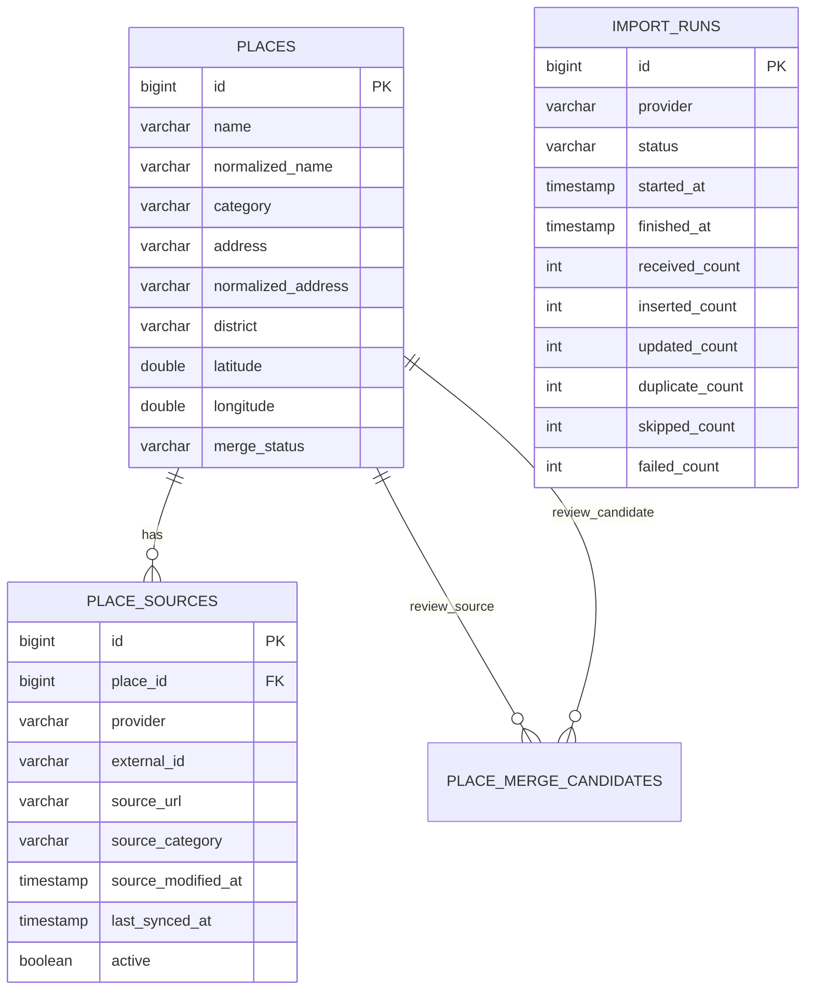

# Phase 2-B-1 통합 장소 DB 및 수집 프로그램

작성일: 2026-10-28

## 구현 범위와 검증 기준

한국관광공사 TourAPI와 부산명소·부산맛집·부산푸디투어·부산 갈맷길 API를 하나의 정규화 파이프라인에 연결했다.
부산버스정보시스템, 자동 스케줄, 카카오 데이터 저장은 이 단계에 포함하지 않았다. 공급자 필드는
`docs/archive/phase2-api-connection-results.md`의 실제 1건 호출에서 확인된 값만 사용한다.
TourAPI `ldongCode2`의 2026-10-28 실제 응답은 `code`/`name` 필드를 사용하므로 코드 `26`, 이름 `부산광역시`를
검증한 뒤 `areaBasedList2`의 각 항목도 `lDongRegnCd=26`인 경우에만 매핑한다.

## 데이터 관계



`place_sources`의 `(provider, external_id)`는 UNIQUE다. 기존 `places.source`와 `places.external_id`는
호환성과 기존 데이터 보존을 위해 유지한다. V6는 기존 `KOR_SERVICE` 행을 `TOUR_API` 원천으로 이관하고,
V7은 정규화 열과 `place_sources.active`만 추가한다. 삭제 또는 테이블 재생성은 없다.

## 공급자 필드 매핑

| 표준 필드 | TourAPI | 부산명소 | 부산맛집 | 부산푸디 | 갈맷길 |
| --- | --- | --- | --- | --- | --- |
| externalId | `contentid` | `UC_SEQ` | `UC_SEQ` | `UC_SEQ` | `uc_seq` |
| name | `title` | `MAIN_TITLE`/`TITLE` | `MAIN_TITLE`/`TITLE` | `MAIN_TITLE` | `title`/`place` |
| address | `addr1`+`addr2` | `ADDR1` | `ADDR1`+`ADDR2` | 없음 | 없음 |
| district | 주소에서 추출 | `GUGUN_NM` | `GUGUN_NM` | 없음 | 없음 |
| coordinates | `mapy`,`mapx` | `LAT`,`LNG` | `LAT`,`LNG` | 실제 표본에 없음 | `lat`,`lng` |
| category | `contenttypeid` | 관광지 | 음식점 | 미식테마 | `cate1_nm` 기반 |
| description | 목록 응답에 없음 | `ITEMCNTNTS` | `ITEMCNTNTS` | `ITEMCNTNTS` | `itemcntnts` |
| image | `firstimage` | `MAIN_IMG_NORMAL` | `MAIN_IMG_NORMAL` | `MAIN_IMG_NORMAL` | `main_img_n` |
| modifiedAt | `modifiedtime` | 없음 | 없음 | 없음 | 없음 |

푸디 표본은 주소·좌표가 없는 미식 테마 콘텐츠이므로 `THEME_CONTENT`로 분류하고 `places` 저장에서 건너뛴다.
갈맷길의 `course`와 `gugan`은 주소로 만들지 않고 `place_sources.source_category`에 원천 분류로 보존한다.

## 정규화와 중복 규칙

- 이름과 주소는 NFKC, 소문자, 공백·구두점 제거 방식으로 비교용 값을 만든다. 원문은 별도 필드에 보존한다.
- 좌표는 WGS84로 간주하며 부산 범위(위도 34.80~35.40, 경도 128.70~129.35) 밖이면 좌표 쌍을 비운다.
- 같은 `(provider, externalId)`는 기존 `PlaceSource`와 연결된 `Place`를 갱신한다.
- 같은 페이지 안의 동일 원천 식별자는 중복으로 집계한다.
- 다른 공급자의 정규화 이름·주소가 같거나 같은 이름이면서 좌표가 100m 이내면
  `place_merge_candidates`에 `PENDING` 후보만 추가한다. 자동 병합하지 않는다.
- 이름, 원천 식별자, 레코드 유형이 유효하지 않으면 건너뛴다.

## 실행 방법

필수 키는 `TOUR_API_KEY`, `BUSAN_ATTRACTION_API_KEY`, `BUSAN_RESTAURANT_API_KEY`,
`BUSAN_FOODIE_API_KEY`, `BUSAN_GALMAETGIL_API_KEY`다. 키는 환경변수에만 두며 로그나 명령 인수에 넣지 않는다.

먼저 최대 10건 Dry-run을 실행한다. Dry-run은 `places`, `place_sources`, `place_merge_candidates`,
`import_runs` 어디에도 변경을 남기지 않는다.

```powershell
.\gradlew.bat bootRun --args="--spring.main.web-application-type=none --place.import.enabled=true --place.import.providers=ALL --place.import.dry-run=true --place.import.page-size=10 --place.import.limit=10"
```

`ALL` 대신 `TOUR_API,BUSAN_ATTRACTION`처럼 선택할 수 있다. 지원 이름은 `TOUR_API`,
`BUSAN_ATTRACTION`, `BUSAN_RESTAURANT`, `BUSAN_FOODIE`, `BUSAN_GALMAETGIL`이다.

실제 저장은 연결 대상이 개발 DB임을 별도로 확인한 뒤에만 실행한다.

```powershell
.\gradlew.bat bootRun --args="--spring.main.web-application-type=none --place.import.enabled=true --place.import.providers=TOUR_API --place.import.dry-run=false --place.import.page-size=10 --place.import.limit=10"
```

## 오류 처리

- HTTP 429와 5xx 및 전송 오류만 최대 3회 시도한다. 인증·요청 형식·API 결과코드 오류는 재시도하지 않는다.
- 공급자 응답 코드가 `00` 또는 `0000`이 아니면 성공으로 취급하지 않는다.
- 개별 항목 매핑/저장 실패는 실패 건수에 반영하고 다음 항목을 처리한다.
- 실제 저장 실행의 API 실패는 `import_runs.status=FAILED`와 키가 제거된 오류 요약으로 남긴다.
- 실행 로그에는 공급자와 집계만 출력하며 키, 키 일부, 원본 요청 URL을 출력하지 않는다.

## 2026-10-28 실제 표본 Dry-run

STS 실행 설정에 등록된 키를 값 노출 없이 자식 프로세스에 전달하고, 운영 MySQL이 아닌 H2 테스트 DB에서
공급자별 최대 10건을 호출했다. 다섯 API 모두 인증 및 JSON 파싱에 성공했다. 실제 DB 저장은 개발 DB 여부가
불명확해 수행하지 않았다.

| Provider | Fetched | Inserted(예상) | Updated | Skipped | Failed |
| --- | ---: | ---: | ---: | ---: | ---: |
| TOUR_API | 10 | 10 | 0 | 0 | 0 |
| BUSAN_ATTRACTION | 10 | 10 | 0 | 0 | 0 |
| BUSAN_RESTAURANT | 10 | 10 | 0 | 0 | 0 |
| BUSAN_FOODIE | 10 | 0 | 0 | 10 | 0 |
| BUSAN_GALMAETGIL | 10 | 10 | 0 | 0 | 0 |

`Inserted`는 빈 H2 DB 기준 예상값이며 Dry-run이므로 실제 저장 건수는 0이다.

## 출처와 이용 조건

- [한국관광공사 국문 관광정보 서비스](https://www.data.go.kr/data/15101578/openapi.do)
- [부산광역시 부산명소정보](https://www.data.go.kr/data/15063481/openapi.do)
- [부산광역시 부산맛집정보](https://www.data.go.kr/data/15063472/openapi.do)
- [부산광역시 부산푸디투어정보](https://www.data.go.kr/data/15063507/openapi.do)
- [부산광역시 갈맷길 관광 정보](https://www.data.go.kr/data/15077606/openapi.do)

공공데이터포털의 이용허락 표시는 원천 메타데이터에 보존한다. 이미지 권리는 본문 데이터와 다를 수 있다.
TourAPI의 `cpyrhtDivCd`를 `image_license`에 그대로 보존하고, 부산 API 이미지도 원본 URL과 출처를 유지한다.
서비스 화면에서 재배포하기 전에는 공급자별 최신 이용조건과 이미지별 권리 표시를 다시 확인해야 한다.

## 다음 단계

Phase 2-B-2에서는 푸디 테마용 컬렉션 모델, 갈맷길 코스-장소 관계, 후보 병합 검토 UI/정책,
비활성 원천 동기화 정책을 추가한다. 버스 정류장·노선 DB는 장소 수집기와 분리한다.
