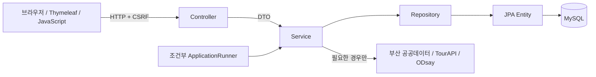
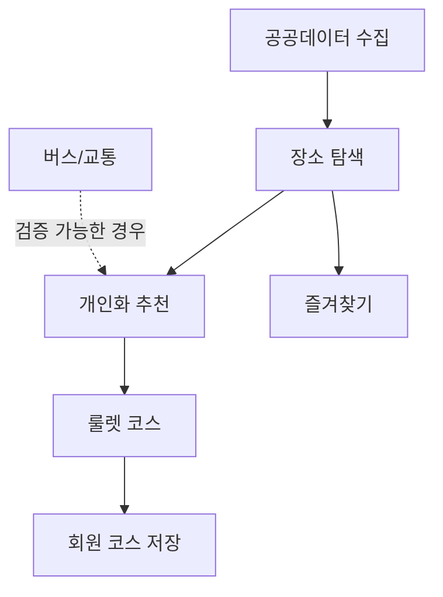

# 02. 시스템 아키텍처

## 전체 구조

## 3계층의 책임

### Controller

- URL, HTTP 메서드, 요청 파라미터를 선언한다.
- Bean Validation으로 입력 범위를 제한한다.
- 인증 사용자는 `Principal` 또는 Spring Security 컨텍스트에서 식별한다.
- Repository를 직접 호출하지 않는다.
- Entity 대신 DTO 또는 View Model을 반환한다.

### Service

- 하나의 사용자 유스케이스를 완성한다.
- 트랜잭션 경계를 선언한다.
- 소유권, 중복, 좌표, 데이터 커버리지 같은 업무 규칙을 검증한다.
- 외부 API 실패를 프로젝트 예외로 변환한다.

### Repository

- Spring Data JPA 기본 CRUD와 파생 쿼리를 사용한다.
- 페이지네이션, 일괄 조회, fetch join, bounding box처럼 DB에서 처리할 조회를 정의한다.
- 화면 문구나 HTTP 상태를 결정하지 않는다.

## 기능별 모듈

## 설정 클래스

| 클래스 | 역할 |
|---|---|
| `SecurityConfig` | 공개/회원/관리자 URL과 로그인·로그아웃 |
| `TourismApiConfig` | 한국관광공사 API URL과 인증 설정 |
| `KakaoLocalApiConfig` | 장소 검색용 Kakao 설정 |
| `OdsayApiConfig` | 외부 대중교통 API 설정 |
| `RecommendationWeights` | 추천 점수 가중치 |
| `*Runner` | 프로퍼티로 명시 활성화하는 수동 검증·수집 |

## 읽기/쓰기 분리

- 탐색과 추천 Service는 대부분 `@Transactional(readOnly = true)`다.
- 코스 저장, 즐겨찾기, 여행 기록, Import Service만 쓰기 트랜잭션을 연다.
- demo 프로필은 Flyway와 자동 수집을 비활성화하고 검증된 복제 DB만 읽고 쓴다.
- 외부 API 키가 없어도 저장된 장소 기반 핵심 기능은 동작한다.

## 보안 경계

`SecurityConfig`가 공개 장소·추천 API를 허용하고 `/my/**`, 저장 코스와 즐겨찾기를 인증 사용자에게만 허용한다. 데이터 동기화는 관리자 역할이 필요하며 CSRF는 기본 보호를 유지한다.
