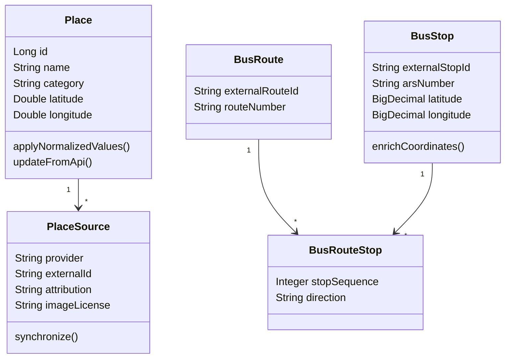
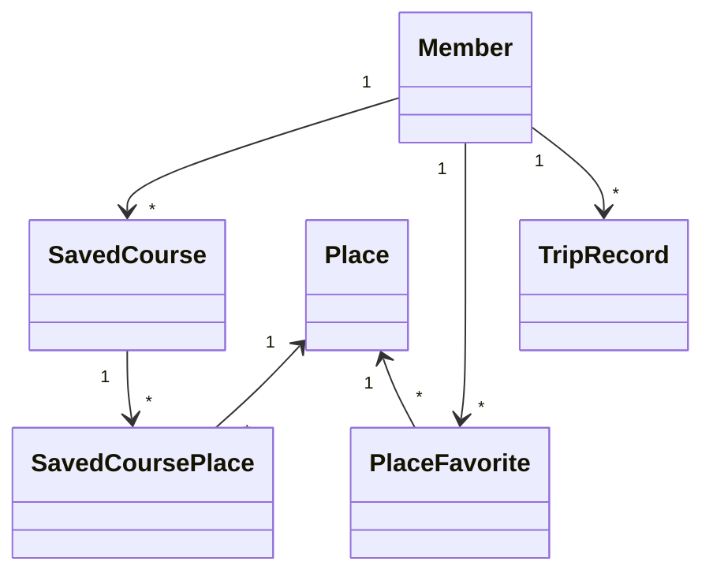
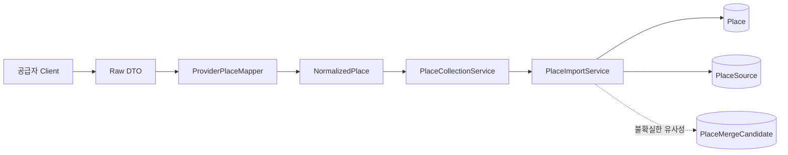

# 03. 주요 클래스 지도

## 장소·출처·교통 도메인

## 회원 도메인

`SavedCoursePlace`는 장소명·카테고리·좌표·점수·추천 이유를 스냅샷으로 보존한다. 원본 `Place`가 변경되어도 저장 당시 코스가 유지되는 이유다.

## 장소 탐색

| 계층 | 클래스 | 핵심 역할 |
|---|---|---|
| Controller | `PlaceExplorerController` | `/places` 화면 |
| REST | `PlaceController` | 페이지·상세 DTO |
| Service | `PlaceExplorerService` | 상세 화면 조합 |
| Service | `PlaceService` | 검색·필터·페이지 |
| Repository | `PlaceRepository` | 키워드·구군·카테고리 조건 |

## 추천과 코스

| 클래스 | 입력 | 출력/책임 |
|---|---|---|
| `RecommendationCandidateFilter` | 추천 조건 | DB 후보 최대 제한 |
| `RecommendationScorer` | 장소·거리·품질 | 0~100 점수와 세부 점수 |
| `PersonalizedRecommendationService` | `RecommendationRequest` | 추천 결과와 한계 |
| `CourseGenerationService` | `CourseGenerationRequest` | 중복 없는 1~5개 방문 순서 |
| `GeneratedCourseRegistry` | 생성 결과 | 짧은 수명의 1회 저장 토큰 |
| `SavedCourseService` | 회원+토큰 | 영속 코스 스냅샷 |

## 공공데이터 수집

## 교통 경로

| 클래스 | 역할 |
|---|---|
| `BusQueryService` | 정류소·노선 조회, 주변 정류소 |
| `TransitGraphService` | 노선 정차 순서를 그래프로 변환 |
| `TransitRoutePlannerService` | 직통·최대 1회 환승 후보 |
| `PlaceTransitEvaluationService` | 추천 후보의 교통 상태 평가 |
| `BusStopEnrichmentService` | 공식 ID/ARS 기준 좌표 보강 |

## 예외 처리

`*ApiExceptionHandler`는 도메인 예외를 HTTP 상태와 `ApiErrorResponse`로 변환한다. 예외 메시지에는 API 키·DB 비밀번호·전체 외부 요청 URL을 넣지 않는다.
