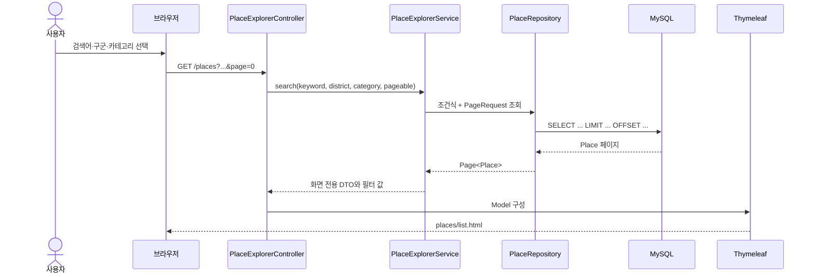
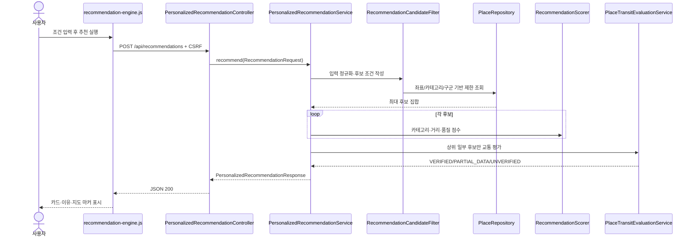
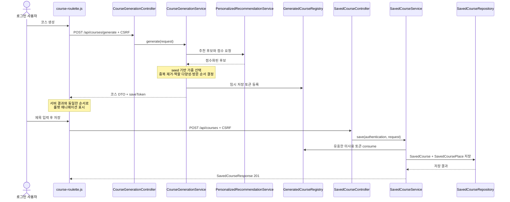
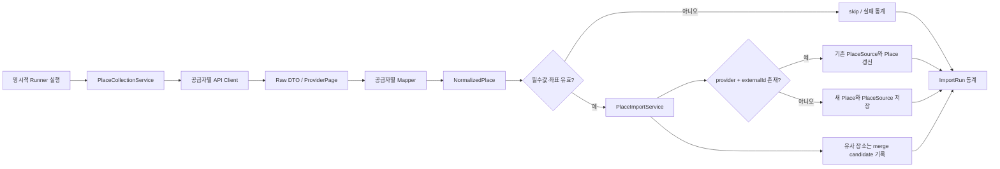

# 요청 처리 흐름

이 문서는 브라우저 요청이 Controller, Service, Repository를 거쳐 화면이나 JSON으로 돌아오는 과정을 추적한다. Controller는 HTTP 경계를, Service는 업무 규칙과 트랜잭션을, Repository는 영속성 접근을 담당한다.

## 1. 관광지 목록과 상세 화면

- 목록은 서버 측 페이지네이션을 사용하므로 전체 장소를 브라우저에 적재하지 않는다.
- `GET /places/{id}`는 장소, 출처, 즐겨찾기 상태, 주변 정류장 정보를 조합한다.
- 없는 ID는 `PlaceNotFoundException`을 거쳐 404 화면 또는 API 오류 DTO로 변환된다.
- Entity를 그대로 JSON으로 노출하지 않고 `PlaceResponse`, `PlaceDetailView` 같은 DTO로 변환한다.

## 2. 개인화 추천

교통 데이터가 부족해도 추천을 중단하지 않는다. 교통 점수를 계산할 수 없는 경우 해당 요소를 분모에서 제외해 나머지 검증 가능한 요소로 점수를 다시 정규화한다.

## 3. 룰렛 코스 생성과 저장

- 생성 API는 DB에 코스를 자동 저장하지 않는다.
- 저장 토큰은 단일 사용이며 만료 또는 재사용 토큰은 거부한다.
- 수정은 `@Version` 값으로 낙관적 잠금을 검사하며 오래된 버전은 HTTP 409로 처리한다.
- 조회·수정·삭제는 로그인 회원과 소유자가 일치할 때만 허용된다.

## 4. 공공데이터 수집

수집기는 일반 웹 요청과 독립적이며 Runner 옵션을 명시했을 때만 동작한다. API 키는 환경변수에서 읽고 로그나 응답에 출력하지 않는다. 이름·주소·좌표가 비슷하다는 이유만으로 다른 공급자의 장소를 자동 병합하지 않는다.

## 5. 오류와 보안 경계

- 폼과 상태 변경 API는 Spring Security의 CSRF 검증을 유지한다.
- 비회원 공개 범위는 장소 탐색·추천 등이며, 코스·즐겨찾기·여행 기록은 인증이 필요하다.
- `*ApiExceptionHandler`는 내부 예외를 일관된 상태 코드와 안전한 오류 DTO로 변환한다.
- JavaScript는 `response.ok`뿐 아니라 서버가 보낸 오류 메시지를 확인하고 로딩·오류·빈 결과 상태를 분리한다.

