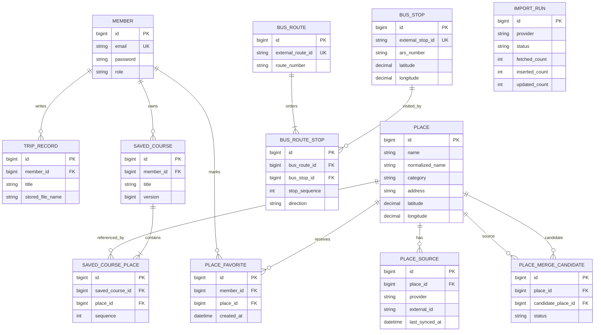
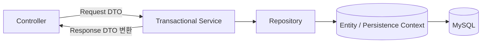

# 데이터베이스와 JPA

## 1. 핵심 ERD



## 2. 무결성 규칙

| 영역 | 핵심 규칙 | 이유 |
|---|---|---|
| 장소 출처 | `UNIQUE(provider, external_id)` | 같은 원천을 재수집해도 `PlaceSource`가 늘어나지 않게 한다. |
| 버스 정류장 | `external_stop_id` 유일 | ARS 번호와 내부 ID를 혼동하지 않고 공식 ID를 기준으로 연결한다. |
| 버스 노선 | `external_route_id` 유일 | 같은 노선 번호라도 서로 다른 내부 노선·방향일 수 있다. |
| 노선 정차 | `(bus_route_id, stop_sequence)` 유일 | 한 노선 안의 검증된 정차 순서를 보존한다. |
| 즐겨찾기 | `(member_id, place_id)` 유일 | 동시 요청에서도 회원별 중복 즐겨찾기를 막는다. |
| 저장 코스 장소 | 코스와 방문 순서 조합 유일 | 한 코스 내 순서 충돌을 막는다. |
| 코스 수정 | `@Version` | 동시에 수정한 오래된 요청을 HTTP 409로 거부한다. |

외래 키는 연결 대상의 존재를 보장한다. 애플리케이션 검증과 별도로 DB의 UNIQUE/FK가 마지막 방어선 역할을 한다.

## 3. JPA 어노테이션 읽기

- `@Entity`: 클래스가 DB 행과 연결되는 영속 엔티티임을 뜻한다.
- `@Table`: 테이블명, 유일성 제약조건과 인덱스를 선언한다.
- `@Id`, `@GeneratedValue`: 기본 키와 생성 전략을 지정한다.
- `@ManyToOne(fetch = LAZY)`: 여러 행이 하나의 부모를 가리키며, 실제 연관 객체는 필요할 때 읽는다.
- `@OneToMany(mappedBy = ...)`: 반대편 FK를 기준으로 자식 컬렉션을 표현한다.
- `cascade = ALL`, `orphanRemoval = true`: 저장 코스의 자식 장소가 부모 생명주기를 따르게 한다.
- `@Version`: UPDATE 시 버전 조건을 추가해 낙관적 잠금을 구현한다.
- `@CreationTimestamp`, `@UpdateTimestamp`: 생성·수정 시간을 영속성 계층에서 기록한다.

Entity의 기본 생성자는 JPA가 사용한다. 도메인 생성자와 `update...` 메서드는 유효한 상태 변경 경로를 드러내며, Controller에서 필드를 직접 변경하지 않도록 한다.

## 4. 트랜잭션과 DTO



- 조회 Service는 가능하면 `@Transactional(readOnly = true)`를 사용한다.
- 저장 Service는 한 업무 단위를 트랜잭션으로 묶어 일부만 반영되는 상태를 방지한다.
- Entity를 HTTP 응답으로 직접 노출하면 지연 로딩, 순환 참조, 내부 컬럼 노출 문제가 생길 수 있어 DTO를 사용한다.
- Controller가 Repository를 직접 호출하지 않는 이유는 업무 규칙과 권한 검사를 Service 한 곳에 모으기 위해서다.

## 5. N+1과 주변 정류장 조회

여러 정류장마다 경유 노선을 개별 조회하면 정류장 수만큼 쿼리가 추가된다. `BusQueryService`는 먼저 bounding box로 좌표 후보를 줄이고, 정류장 ID 목록으로 노선 관계를 일괄 조회한 후 메모리에서 Haversine 거리와 DTO를 조합한다.

```text
나쁜 흐름: 정류장 1 조회 → 노선 조회, 정류장 2 조회 → 노선 조회, ...
현재 흐름: bounding-box 정류장 조회 1회 → ID 목록 노선 관계 조회 1회 → 그룹화
```

## 6. Flyway 이력

Flyway SQL은 이미 적용된 파일을 수정하지 않고 다음 버전 파일을 추가하는 방식으로 관리한다.

| 버전 | 목적 |
|---|---|
| V1~V4 | 장소, 회원, 여행 기록의 기초 스키마 |
| V5~V7 | 통합 장소 검색, 출처, 수집 이력, 다중 공급자 확장 |
| V8~V9 | 버스 정류장·노선·정차 관계와 좌표 인덱스 |
| V10 | 회원별 저장 코스 |
| V11 | 장소 즐겨찾기 |
| V12 | 레거시 장소 외부 ID의 공급자 범위 정리 |

원본 DB와 demo/격리 DB는 목적과 연결 설정이 다르다. 프로필을 바꿀 때 JDBC 대상과 Flyway 상태를 먼저 확인하며, 애플리케이션 시작 시 데이터 초기화나 자동 수집을 하지 않는다.

