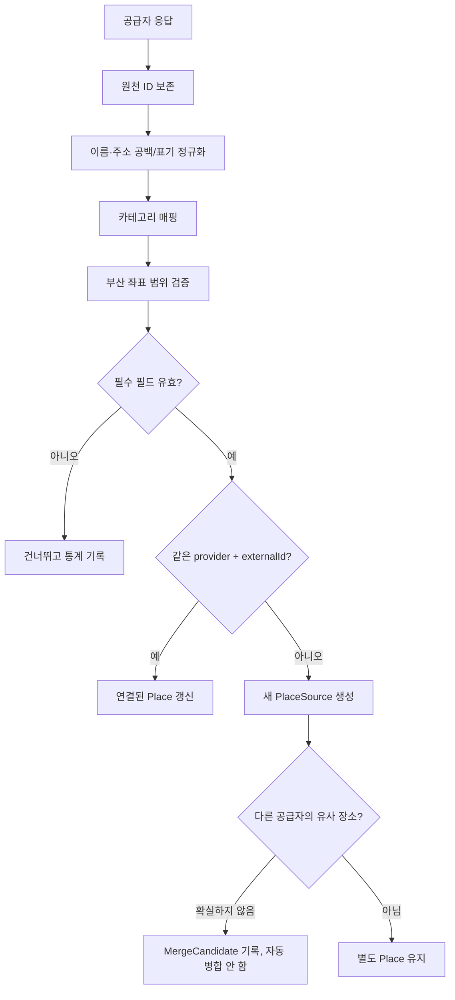
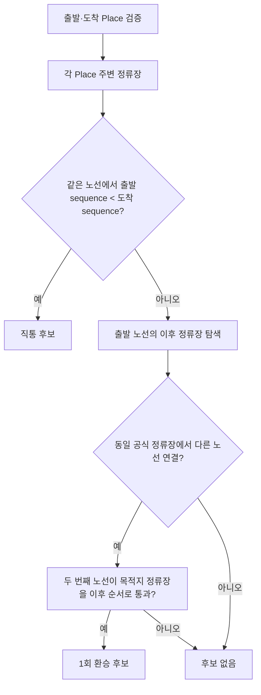

# 핵심 알고리즘

## 1. 장소 수집·정규화·멱등 저장

공급자별 응답은 `ProviderPlaceMapper` 구현체가 공통 `NormalizedPlace`로 변환한다. 이 경계 덕분에 저장 로직은 JSON/XML 필드명이 아니라 표준 필드만 다룬다.



핵심 멱등성 키는 `(provider, externalId)`다. 장소명만 같은 경우, 좌표가 가까운 경우, 주소 표기가 비슷한 경우는 검토 신호일 뿐 자동 병합 근거가 아니다.

## 2. 개인화 추천 점수

`RecommendationScorer`는 각 요소를 0~100으로 만들고 설정 가중치로 가중 평균한다.

```text
기본 가중치
카테고리 30 + 거리 30 + 다양성 15 + 데이터 품질 15 + 교통 10

total = Σ(elementScore × weight) / Σ(appliedWeight)
```

- 카테고리: 선호 목록이 비었거나 일치하면 100, 아니면 0이다.
- 거리: 설정된 최대 거리(기본 50km)까지 선형으로 감소한다.
- 다양성: 같은 후보군 안에서 카테고리의 희소도를 반영한다.
- 데이터 품질: 기본 60점에 주소 20, 설명 10, 허용 가능한 이미지 10을 더한다.
- 교통: 실제로 평가 가능한 상위 후보에만 적용한다. 데이터가 부족하면 0점 벌점이 아니라 가중치 자체를 제외한다.

시간·입장료·교통요금 자료가 없을 때 값을 추정하거나 점수로 만들지 않는다. 응답의 `dataLimitations`에 평가 불가 사실을 표시한다.

## 3. seed 기반 가중 랜덤 선택

`randomness=0`이면 점수와 안정적인 보조 정렬 기준으로 결정론적 상위 후보를 선택한다. 랜덤성이 커질수록 낮은 순위 후보도 선택될 확률이 커지지만 필수 검증, 좌표, 중복 금지 조건은 유지한다.

```text
후보 = 점수화된 제한 후보
선택 = []
random = Random(randomSeed)

while 선택 수 < 요청 수 and 후보가 남음:
    역할/카테고리 다양성을 만족하는 풀을 우선 구성
    각 후보의 점수와 randomness로 선택 가중치 계산
    random으로 1개 선택
    선택된 장소를 후보에서 제거
```

같은 입력 후보와 같은 seed는 같은 선택을 재현한다. 브라우저 룰렛은 서버가 확정한 순서를 보여주는 시각 효과일 뿐 별도의 장소를 뽑지 않는다.

## 4. 코스 방문 순서

선택된 장소는 출발점에서 시작하는 nearest-neighbor 휴리스틱으로 정렬한다.


이 방식은 빠르고 설명하기 쉽지만 전역 최단 경로를 보장하지 않는다. 사용되는 거리는 좌표 간 직선거리이며 실제 도로·도보·버스 이동거리나 소요시간이 아니다. 역할 그룹과 카테고리 다양성은 선택 단계에서 고려하고, 같은 장소는 한 코스에 두 번 들어가지 않는다.

## 5. 거리 계산과 bounding box

정확한 후보 판정은 `DistanceCalculator`의 Haversine 공식을 사용한다.

```text
a = sin²(Δlat/2) + cos(lat1) × cos(lat2) × sin²(Δlon/2)
c = 2 × atan2(√a, √(1-a))
distance = EarthRadius × c
```

모든 정류장을 JVM으로 읽지 않기 위해 먼저 반경을 위도·경도 차이로 환산한 사각형 쿼리를 실행한다. 사각형은 빠른 후보 축소용이고, 최종 포함 여부와 정렬은 Haversine 결과로 결정한다.

## 6. 버스 직통·1회 환승 탐색

그래프의 간선은 무방향 연결이 아니라 `(노선, 방향, 정차 순서)`를 보존한다.



- 같은 노선 번호라도 외부 노선 ID와 방향이 다르면 별개로 취급한다.
- 출발 순서가 도착 순서보다 뒤면 반대 방향으로 보고 해당 구간을 반환하지 않는다.
- 정차 순서가 누락되거나 일부 구간만 적재된 경우 `PARTIAL_DATA` 또는 `UNVERIFIED`로 표시한다.
- `NO_CANDIDATE`는 현재 DB 범위에서 후보가 없다는 뜻이며 부산 전체에서 이동 불가능하다는 뜻이 아니다.
- 서로 다른 정류장 사이 도보 환승은 실제 이동 가능성을 검증하지 못했으므로 확정 경로로 만들지 않는다.

