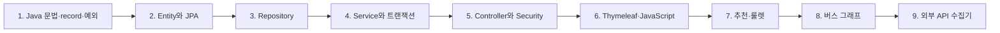

# 학습 가이드

## 권장 학습 순서



## 1단계: 애플리케이션 입구

1. `CityRouletteApplication`에서 `@SpringBootApplication`이 컴포넌트 스캔과 자동 설정을 시작하는 과정을 본다.
2. `application.properties`, `application-dev.properties`, `application-demo.properties`에서 환경별 설정 차이를 비교한다.
3. `SecurityConfig`에서 공개 URL, 로그인, CSRF, 비밀번호 인코더를 찾는다.

확인 질문: 서버 시작만으로 데이터 수집 Runner가 실행되지 않게 하는 조건은 무엇인가?

## 2단계: 가장 짧은 CRUD 흐름

`PlaceExplorerController` → `PlaceExplorerService` → `PlaceRepository` → `Place` 순서로 읽는다.

- Controller의 쿼리 파라미터가 Service 인자로 어떻게 바뀌는가?
- `Pageable`이 SQL의 LIMIT/OFFSET으로 어떻게 이어지는가?
- 왜 Entity 대신 `PlaceDetailView`를 화면 모델에 사용하는가?

연습: 카테고리와 구·군을 함께 검색했을 때 호출되는 Repository 메서드와 반환 타입을 종이에 그린다.

## 3단계: 회원 소유 데이터

`PlaceFavoriteService`, `SavedCourseService`, `TripRecordService`를 비교한다.

- 인증 객체에서 회원을 식별하는 위치
- 소유권을 확인하는 위치
- `@Transactional` 경계
- UNIQUE 제약과 서비스 중복 검사의 역할 차이
- `SavedCourse.version`으로 충돌을 검출하는 과정

연습: 다른 회원이 코스를 수정하려 할 때 Controller부터 예외 처리기까지의 경로를 추적한다.

## 4단계: 프론트엔드 요청

`recommend.html`, `recommendation-engine.js`, `course-roulette.js`를 함께 읽는다.

- `data-*` 속성이 JavaScript 요소 선택과 어떻게 연결되는가?
- CSRF 토큰을 어떤 헤더에 담는가?
- 로딩·오류·빈 결과 상태가 어떻게 분리되는가?
- `prefers-reduced-motion`에서 룰렛 애니메이션이 어떻게 달라지는가?
- Leaflet이 없거나 인터넷이 끊겼을 때 어떤 안내가 표시되는가?

브라우저 개발자 도구의 Network 탭에서 요청 JSON, 응답 DTO, HTTP 상태를 확인하면 흐름을 가장 빨리 이해할 수 있다.

## 5단계: 추천과 코스

다음 순서로 읽는다.

1. `RecommendationRequest`
2. `RecommendationCandidateFilter`
3. `RecommendationScorer`
4. `PersonalizedRecommendationService`
5. `CourseGenerationService`
6. `GeneratedCourseRegistry`

연습: 동일한 seed가 같은 결과를 만드는 테스트를 실행하고, randomness 0과 100에서 선택 코드가 갈라지는 지점을 찾는다.

## 6단계: 좌표와 버스 그래프

`DistanceCalculator` → `BusQueryService` → `TransitGraphService` → `TransitRoutePlannerService` 순서로 읽는다.

- bounding box와 Haversine의 역할 차이
- 노선 번호와 외부 노선 ID의 차이
- 정류장 ID와 ARS 번호의 차이
- 정차 순서와 방향을 무시하면 왜 잘못된 경로가 생기는가?

연습: Fixture의 직통, 반대 방향, 1회 환승 사례를 그림으로 옮기고 서비스 결과와 비교한다.

## 7단계: 공공데이터 수집

`PlaceDataProvider` 인터페이스부터 시작해 한 공급자를 끝까지 따라간다.

```text
Client → Provider → Raw DTO → ProviderPlaceMapper → NormalizedPlace
→ PlaceImportService → Place / PlaceSource / ImportRun
```

TourAPI 한 개를 이해한 뒤 부산명소·맛집·갈맷길 Mapper 차이를 비교한다. 환경변수 값은 출력하지 말고 설정 여부만 확인한다.

## 테스트를 학습 도구로 쓰기

- 단일 클래스: `gradlew test --tests "패키지.클래스명"`
- 단일 메서드: `gradlew test --tests "패키지.클래스명.메서드명"`
- 전체 회귀: `gradlew clean test`
- 제출 전: `gradlew clean build`

테스트 이름을 먼저 읽고 Given-When-Then 구조로 구현을 역추적한다. 실제 MySQL/API 검증과 H2/Fixture 테스트는 같은 것으로 해석하지 않는다.

## 학습 체크리스트

- [ ] URL 하나를 Controller부터 SQL까지 추적할 수 있다.
- [ ] Entity와 응답 DTO의 차이를 설명할 수 있다.
- [ ] 트랜잭션과 DB UNIQUE/FK의 역할을 설명할 수 있다.
- [ ] 추천 점수의 각 요소와 데이터 부족 처리를 설명할 수 있다.
- [ ] seed 재현성과 룰렛 애니메이션의 역할을 구분할 수 있다.
- [ ] 직통·환승 탐색에서 정차 순서가 필요한 이유를 설명할 수 있다.
- [ ] 수집 재실행 시 중복이 늘지 않는 이유를 설명할 수 있다.

