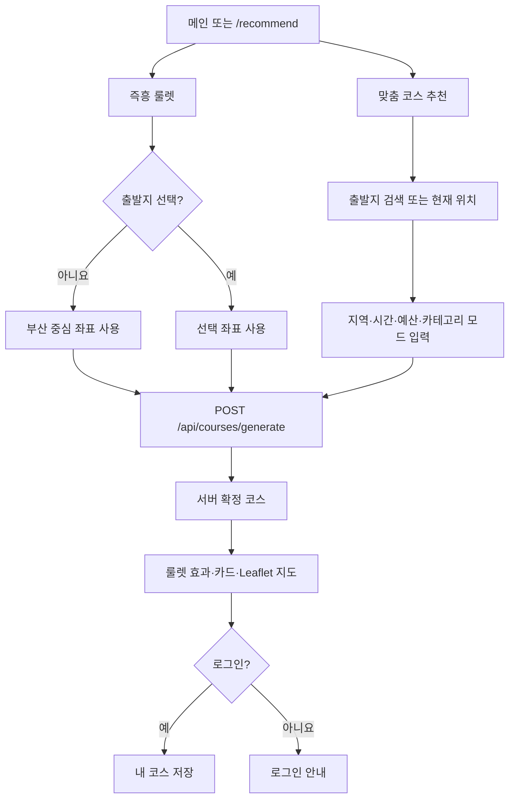

# 사용자 흐름

즉흥 룰렛과 맞춤 코스는 어느 쪽도 다른 기능을 먼저 실행할 필요가 없다. 출발지 검색 상태만 페이지 안에서 공유한다.

## 반응형 원칙

- 700px 이하에서는 기능 선택 카드와 카테고리 모드가 한 열로 배치된다.
- 카테고리는 `white-space: nowrap`인 선택 칩으로 표시해 글자 단위 줄바꿈을 막는다.
- 모든 칩은 실제 체크박스와 연결되어 키보드 및 스크린 리더 입력을 유지한다.
- `prefers-reduced-motion`에서는 룰렛 반복 애니메이션 없이 확정 결과를 즉시 표시한다.
