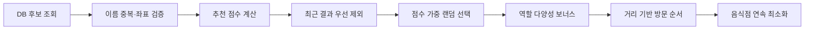

# 추천·랜덤 알고리즘

## 카테고리 모드

- `PREFERRED`(기본): 선택 카테고리를 추천 점수에 반영하되 다른 카테고리도 후보로 유지한다.
- `REQUIRED`: 선택한 역할의 후보를 최소 한 곳씩 먼저 선택하도록 시도한다. 실제 후보가 없으면 임의 장소를 만들지 않는다.
- `ONLY`: 선택 카테고리를 DB 조회 조건으로 사용한다.

## 즉흥 룰렛 다양성

브라우저는 마지막 추천 장소 ID를 개인정보가 없는 `localStorage`에 최대 30개 보관하고 다음 기본 랜덤 요청의 `excludedPlaceIds`로 보낸다. 서버는 제외 후에도 요청 장소 수만큼 후보가 있을 때 최근 결과를 제외한다. 후보가 부족하면 결과 수를 불필요하게 줄이지 않도록 전체 후보를 다시 허용한다.

명시적인 `randomSeed`가 있으면 제외 기록을 적용하지 않는다. 따라서 동일 후보와 동일 seed의 결과 재현성이 유지된다.

## 선택 및 순서

- randomness 0: 점수와 새 카테고리 보너스를 이용한 결정론적 선택
- randomness 1~100: 점수 기반 가중치의 집중도를 낮춰 선택 폭 확장
- 방문 순서: nearest-neighbor를 기준으로 하되 기존 1.35배 + 1km 허용 범위 안에서 역할 다양성과 음식점 연속 수를 개선
- 거리: Haversine 직선거리이며 실제 이동시간이나 도로 경로로 표시하지 않음

교통 데이터가 부족하면 장소를 제거하지 않고 `교통 정보 확인 필요`로 표시한다.

기본 선호 모드에서 상위 200개 후보에 관광지·카페·음식점·문화시설 중 일부 역할이 없으면, 없는 역할만 `ONLY` 조회로 최대 10건 보충한다. 보충 후보의 점수와 이유는 사용자가 실제로 선택한 선호 기준으로 다시 정규화한다. 원본 DB에 후보가 없는 유형은 만들지 않고 제한사항에 표시한다.
