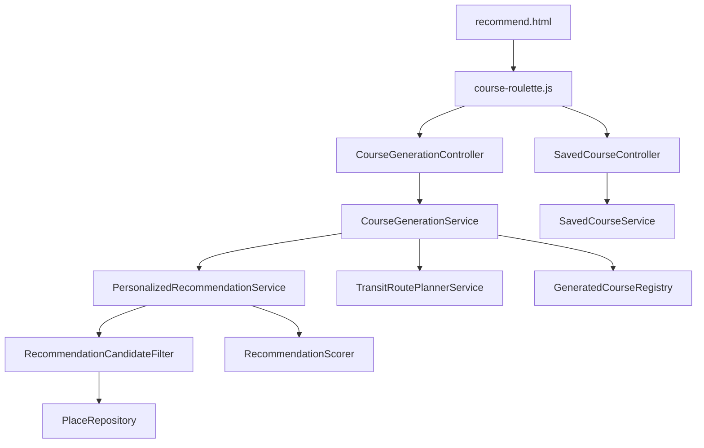

# 클래스 연결 관계

## 핵심 메서드

- `CourseGenerationController.generate`: 요청 검증 후 서비스 호출
- `CourseGenerationService.generate`: 모드 결정, 추천 후보 수집, 장소 선택, 순서 생성, 저장 토큰 발급
- `CourseGenerationService.applyRecentExclusions`: 고정 seed가 아닐 때 최근 결과를 우선 제외
- `RecommendationCandidateFilter.select`: ONLY일 때만 카테고리를 DB 배타 조건으로 적용
- `PersonalizedRecommendationService.recommend`: 표준 점수와 추천 이유 계산
- `GeneratedCourseRegistry.issue`: DB 저장 전 단기 저장 토큰 발급

`CategorySelectionMode`와 `CourseGenerationMode`는 화면 의미를 서비스 계층까지 명확하게 전달한다. 기존 10개 인자 DTO 생성자는 유지해 기존 코드와 테스트의 하위 호환성을 보존했다.
